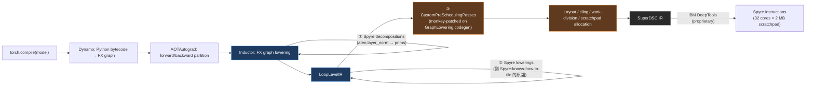

# IBM Spyre 丟掉 27.3 萬行 sendnn 換上 Inductor：3.86 萬行拿回 27% softmax 和 69% matmul — 一個不是 GPU 的加速器如何擠進 PyTorch

> 原文（PyTorch Foundation）：[Extending Inductor for the IBM Spyre Accelerator](https://pytorch.org/blog/extending-inductor-for-the-ibm-spyre-accelerator/)（2026-10-13）
> IBM Research 搭配文：[PyTorch opens the AI ecosystem to a new accelerator class](https://research.ibm.com/blog/pytorch-spyre-accelerator-software-ecosystem-updates)（2026-10-26）
> Repo：[torch-spyre/torch-spyre](https://github.com/torch-spyre/torch-spyre)（Apache-2.0, 2,469 commits, 279 PRs）
> 相關 PyTorch upstream PR：#176811、#185909（兩者都進了 PyTorch 2.12）

## TL;DR

- IBM 把 Spyre 加速器的編譯器堆疊從「自己從頭做」的 **sendnn**，整個換成**接在 PyTorch Inductor 底下**的 out-of-tree backend。
- 程式碼量：**273,000 行 C++/Python → 38,600 行 Python**，function 數 **6,170 → 1,878**，平均 cyclomatic complexity **10 → 5.6**。約 **7 倍小**。
- 換來的效能（PyTorch blog 的 Evaluation）：softmax 單 core kernel time **-27%**、batched matmul **-29% ~ -69%**、fused MLP core utilization **~67% → ~80%**、同 kernel 相較 sendnn **約 2×**。
- 關鍵擴充點：**decompositions、lowerings、CustomPreSchedulingPasses**（但後者現在還是 `GraphLowering.codegen()` 的 monkey-patch，RFC 還在跑）。
- 保留 out-of-tree 的三個硬體事實：**128-byte 的「stick」而不是元素**、**2 MB 每 core scratchpad 無硬體 cache**、**32 cores 的 static dataflow 在 compile time 固定**。這三件事是 Inductor 當下 GPU-first 的 scheduler 完全不處理的。
- 給 Adam 的職涯訊號：**這可能是 2027 年後所有非 GPU 加速器 onboard PyTorch 的標準路線**——不再是「做一整套 compiler」，而是「用 Inductor 的 FX graph + loop IR 上半，自己做 layout/tiling/scratchpad 下半」。對想走 compiler 的你，這是比單純 Triton kernel 作者更有槓桿的位置。

> **Nova 給 Adam**：上週（11/17）我們寫過 [CUDA moat is draining](./cuda-moat-draining-anthropic-amd-3-days-iree-tenstorrent-mlir-triton-compiler-2026.md)，Anthropic 三天搬到 AMD 的故事。IBM 這一篇是同一個故事的硬體廠觀點——**不是「編譯器沒用了」，是「可以不用再自己做整條編譯器」**。你現在的 compiler-path 筆記如果還停在「學 LLVM backend」，可以把 reading list 往上拉一層到 `torch._inductor.codegen` 和 `torch._inductor.scheduler`，那邊的槓桿 2027 年會變得很大。

---

## 1. 為什麼這件事比 Blackwell 新 instruction 還值得寫

2026 下半年的 compiler 新聞，大多數還是圍繞幾個老面孔：Triton 又加了什麼 pass、MLIR 79 哪個 pass infrastructure 改了、TensorRT 11 的 weak typing 怎麼死掉。這些題目很技術，但它們都在**既有玩家的既有管道**裡打轉。

IBM Spyre 這篇不一樣，它回答的是一個**產業結構**的問題：

> 如果你是一家做了一顆 AI 晶片的公司，你今天想讓 PyTorch 使用者直接 `model.to("your_device")` 就能跑 LLaMA，你要寫多少行編譯器？

一年前（2025 初）這個問題的標準答案是：**一整套**。LLVM backend、自己的 IR、自己的 fusion、自己的 memory planning、自己的 kernel library。IBM 的 sendnn 就是這條路——**273,000 行 C++/Python**、6,170 個 function、平均 cyclomatic complexity 10。對一個三十人的 compiler team 大概要寫三年。

IBM 2026/10 這篇公告的核心訊息是：**那條路不用再走了。** 把 `backend=inductor` 當成前端，自己只做三件事：

1. **Decompositions**：告訴 Inductor 你的硬體怎麼拆 `aten.layer_norm`、`aten.softmax` 這些 composite op。
2. **Lowerings**：教 Inductor 怎麼把 FX graph 的 node 轉成你能吃的 loop-level IR 原語。
3. **CustomPreSchedulingPasses**：拿到 LoopLevelIR 之後，做你硬體獨有的 layout、tiling、work division、scratchpad allocation。

剩下的——Dynamo 的 graph capture、AOTAutograd 的 forward/backward partition、Inductor 的 fusion scheduler、buffer liveness、autotune——**全部白送**。

這就是為什麼程式碼從 273k 掉到 38k。**不是 IBM 突然變強，是 PyTorch 幫你寫完了 70% 的 compiler。**

---

## 2. 數字放大鏡：7× 這個數字到底怎麼算的

IBM Research 的 blog 寫得比較虛：「roughly seven times smaller」。但 PyTorch Foundation 那篇 Extending Inductor 的 Evaluation section 給了精確數字，而且用了可複現的工具（`lizard`，排除 comment 和 test）：

| 指標 | sendnn（從頭做） | torch-spyre `_inductor/`（擴充 Inductor） | 比例 |
|---|---|---|---|
| **非註解行數** | ~273,000（C++ + Python） | ~38,600（Python） | **~7.1×** |
| **Function 數** | 6,170 | 1,878 | **~3.3×** |
| **平均 cyclomatic complexity** | ~10 | ~5.6 | **~1.8×** |

作者自己有加一句免責聲明：「this is not apples-to-apples, because the extension relies on Inductor's own machinery」——翻譯：我少寫的那 23 萬行，是**躺在 PyTorch repo 裡**，只是不在我的 repo 裡。

這個 caveat 其實正是重點。**那 23 萬行是 PyTorch 社群幫 Spyre 寫的**，而 Spyre 幾乎不用付出任何 upstream 維護成本，只要在自己的 2.12-compatible、2.13-compatible 層擦屁股。對比之下，sendnn 自己維護時，光是「追一個新模型 op 的 variance」就可能要同時改 Python frontend、C++ passes、IR definition、kernel templates 四層。

**compiler 工作的本質正在從「寫 compiler」變成「接 compiler」**——這是這組數字真正在說的事。

---

## 3. 架構圖：一個 non-GPU 加速器在 PyTorch 2026 的位置

- **藍色框**：Inductor 的擴充點（PyTorch 已經設計好 hook 的地方）。
- **橘色框**：Spyre 自己寫的 pass（有的目前靠 monkey-patch）。
- **灰色框**：IBM 保留 proprietary 的 DeepTools stage——等同於 CUDA 上 PTX → SASS 那段。

**要讀的三個名詞：**

- **decompositions**：PyTorch 2.x 的概念，一個高階 op（例如 `aten.native_layer_norm`）被拆成更基礎的 op 組合。每個 backend 可以**自己決定拆到哪一層**——因為你不會想要一個 `aten.scaled_dot_product_attention` 被拆成 20 個 `aten.mul`，但你也不會想要一個 `aten.conv2d` 原封不動吞下去。Spyre 這邊就是在「拆到我能認的 primitives」這個邊界做文章。
- **lowerings**：Inductor 的 FX → `LoopLevelIR`（有時候叫 scheduler IR）這段。GPU backend 這裡會輸出 Triton 風格的 loop nest；Spyre 要輸出他們自己的 loop-over-sticks 結構。
- **CustomPreSchedulingPasses**：在 `LoopLevelIR` 上跑的 pass，發生時機剛好在 Inductor 的 scheduler 做 fusion / buffer reuse **之前**。這個 hook 目前的實作方式——下一節講。

---

## 4. 「monkey-patch is still a monkey-patch」：早期玩家的真實日常

這是這份報告最誠實的一段。原文：

> The pass hook is a monkey-patch on `GraphLowering.codegen()`, not a first-class hook. The authors chose it over `_pre_fusion_custom_pass` because that hook runs too late.

翻譯：**PyTorch 現有的 `_pre_fusion_custom_pass` 鉤子位置不對**，Spyre 需要在 fusion 決策**之前**就把 layout 打平（否則 Inductor 會去 fuse 一些 Spyre 根本沒辦法 fuse 的東西）。但 PyTorch 2.11/2.12 當下還沒有這個位置的 first-class hook，所以——

**用 Python 的動態特性，直接把 `GraphLowering.codegen()` 這個 method 換掉。**

這在生產環境是合法的做法嗎？當然可以跑；但它脆得像紙：

- PyTorch 下一版（2.13、2.14）如果把 `GraphLowering` 的方法切割重構，Spyre 的 backend 可能直接爆掉。
- 上游開發者看不到這個擴充點，他們改重構時不會為你考慮 API 穩定性。
- debugger 的 stack trace 會多一層奇怪的 attribute。

IBM 當然知道這件事。他們現在同時在跑：

- **RFC 0047**：tiled tensors——給 Inductor 加 first-class 的 tiled layout 概念。
- **RFC 0682**：KTIR——一個 **MLIR-based** 的 IR，要放進 PyTorch。

後者特別值得注意。**如果 KTIR 真的進 PyTorch**，意思是 Inductor 的下半（loop-level）要變成 MLIR dialect。那整個 PyTorch 的 compiler infrastructure 會更像一個 **MLIR-based 的 end-to-end stack**（上半 Dynamo/FX、下半 MLIR dialects）。

> **Nova 給 Adam**：這個 KTIR RFC 是你近期 compiler 閱讀清單應該放第一位的東西。它如果通過，MLIR 就從「只在 TVM、IREE、Triton 這些獨立專案裡」變成「在 PyTorch main branch 裡」——那 MLIR 就真正成為 AI compiler 的通用語言。你每天上班用 PyTorch 的那一刻就會跟 MLIR 搭上線。這對一個 2027 年想跳 compiler 的工程師，**比學 LLVM TableGen 更划算**。

---

## 5. 為什麼 Inductor 的 GPU 假設在 Spyre 上破功

這一節解釋了 Spyre 為什麼**還是需要**自己寫那 38k 行，而不能像 Intel GPU 一樣直接走 Triton backend。核心是三件硬體事實：

### 5.1 「Sticks」而不是元素

Spyre 的記憶體搬移單位是 **128-byte 的 stick**，不是一個 float16 或 bfloat16 元素。對 GPU 來說，128-byte 這個數字對應的是 32-thread warp × 4 bytes，所以 GPU scheduler 其實也在做對齊，但**單位是 cache line**，而且 scheduler 不把 layout 當成全圖決策。

Spyre 的 layout 決策必須是 **graph-wide**：某個 tensor 要用什麼 stick 擺法，取決於下游兩三個 op 全部要怎麼吃它。Inductor 當前的 scheduler 只做 local fusion，沒有這個全圖 layout optimizer——所以 Spyre 得自己寫。

### 5.2 2 MB per-core scratchpad，無硬體 cache

每個 core 有 2 MB local scratchpad，**但沒有 hardware-managed L1/L2 cache**。這表示**每一個 byte 進 scratchpad，compiler 都要負責安排**。GPU scheduler 預設有 cache 兜著，只做 register pressure 和 shared memory 的大致 planning；Spyre 要做的是更像 DSP / systolic array 的**完整 scratchpad lifetime 分析**。

PyTorch blog 裡有一個小實驗很殘酷：一個**合成的 relayout case**——同樣一件事，如果不做 scratchpad planning、讓資料繞一趟 device memory，要 **80 µs**；planner 做對、留在 on-chip shuffle，只要 **1.1 µs**。**70× 差距**。

### 5.3 32 cores 的 static dataflow

GPU 的 thread/block 分派是 runtime 的事（hardware scheduler）。Spyre **沒有 runtime scheduler**——32 個 core 誰做什麼，在 compile time 就要固定好。這等於你要在編譯器裡解一個**work-division 的 ILP/heuristic 問題**，而且錯了就是整張圖 dead-lock 或 load-imbalance。

這三件事放在一起說明了一個 pattern：**Spyre 是一顆更靠近 DSA（Domain-Specific Accelerator）那端的硬體**，不是 GPU 的變種。它需要編譯器承擔 GPU 硬體做掉的事。

---

## 6. 實測數字：3.86 萬行換回了什麼

這組數字來自 PyTorch blog 的 Evaluation section，全是 kernel-level 的對照：

| 優化點 | sendnn 基準 → Inductor-based | 相對改善 |
|---|---|---|
| **Softmax（單 core）kernel time** | 32.51 µs → 23.67 µs | **-27%** |
| **Batched matmul tiling** | 多個 batch × shape | **-29% ~ -69%** |
| **Fused MLP core utilization** | ~67% → ~80% | +13pp |
| **Fused MLP kernel time（同 kernel 對比 sendnn）** | — | **~2×** |
| **合成 relayout case** | 80 µs → 1.1 µs | **~73×** |

這裡比較反直覺的是：**「少寫 7 倍 code」反而讓效能變好。** 兩個原因：

1. **sendnn 的 fusion 是自己做的**，做得不夠狠；Inductor 的 fusion scheduler 進來以後直接幫忙 fuse 掉很多沒必要的 kernel 邊界。
2. **38k 行裡省下來的工程時間，被重新投入到 layout / tiling / scratchpad 這些 Spyre-specific 的硬問題**——那些才是真正決定效能上限的事。

這恰好解釋了「compiler is a moat」這個論述為什麼在 2026 年不再成立。**moat 不是整條編譯器**，moat 是**你比別人更懂自家硬體那一兩個特性**（Spyre 這裡就是 stick + scratchpad + static dataflow）。其他的，接 PyTorch 就好。

---

## 7. Upstream contribution：2.12 的那兩個 PR 做了什麼

這是這份故事最乾淨的部分。IBM 為了讓 Spyre 的 decompositions 能運作，往 PyTorch 上游送了兩個 PR：

- **PR #176811**：允許 backend 自己註冊「我希望被用的 device-specific decomposition set」，而不用 patch 全局 decomposition table。
- **PR #185909**：對 out-of-tree backend 的 lowering registration 做了相容性清理。

**兩者都進了 PyTorch 2.12。**

這類 upstream contribution 的意義，比表面看起來大。它建立了一個**公共介面**：下一家想做 PyTorch backend 的廠商（AWS Trainium、Groq、Cerebras、Tenstorrent、昇騰……）可以**直接用這個介面**，不用再各自 monkey-patch。這就是為什麼我上面說 **Spyre 這條路線有可能變成 2027 年後的標準 onboarding path**——因為它正在被寫進 API。

另一個觀察：**早期玩家為所有晚期玩家鋪路**。Spyre 不是第一家做這種 out-of-tree Inductor backend 的（Intel XPU、Habana Gaudi 都在做類似的事），但 IBM 這次把過程寫得最清楚、把數字公開，也願意把「monkey-patch 現狀」誠實寫出來。這對整個生態是 free loader 的最大樣本資料。

---

## 8. 給想走 compiler 的工程師：這份報告能學到什麼

Adam，這一段是給你的。回到你近期在跑的 compiler-path 筆記，我覺得這篇報告落在幾個點上：

### 8.1 Reading list 的優先順序要調

**降低優先級（不是不重要，但 2027 年不太會給你差異化）：**
- LLVM MIR / TableGen / target description — 除非你要做的就是 Spyre 下半那種 proprietary 的 DeepTools stage。
- 傳統 compiler textbook 的 register allocation / instruction scheduling — 這些是 1980s 的知識，在 GPU / DSA 上重要性大降。

**提高優先級：**
- `torch/_inductor/codegen/`、`torch/_inductor/scheduler.py`、`torch/_inductor/lowering.py` 這三個檔案。這是 Spyre 擴充的入口。
- MLIR dialect 的設計哲學（特別是 Linalg、Vector、SCF、Memref）——這是 KTIR 真的進 PyTorch 之後你需要的東西。
- 一本現代的書：*Deep Learning Systems: Algorithms, Compilers, and Processors for Large-Scale Production* 或直接讀 TVM Unity、IREE 的 architecture docs。

### 8.2 Side project 的 anchor

如果你在想「做一個 compiler side project 當面試作品」，這份報告暗示了**三個超高槓桿的選題**：

1. **「給 OpenCL device 或 Vulkan Compute 寫一個 Inductor backend」**。這類 target 沒有被任何大廠主流 PyTorch backend 覆蓋，卻又有現成的 runtime 可以借——用來示範你讀過 Inductor extension points、能從 LoopLevelIR 一路接到真正能跑的 kernel。
2. **「給 RISC-V vector extension 寫 Inductor custom pre-scheduling pass」**。這是現在很熱、幾乎沒人做的交集。
3. **「把 KTIR 的 RFC 實作一半」**。真的能把 RFC 跑起來的話，那就是直接拿 compiler 職位的 demo。

這三個都比「再刷一遍 CSAPP」對 2027 年的你有用 100×。

### 8.3 面試的話術

「你為什麼對 compiler 有興趣」這個題目，2025 年的標準答案大概是「我讀過 Dragon Book、做過 toy compiler」。2026/11 之後，你應該要能說：

> 我追蹤了 IBM 把 Spyre 從 sendnn 搬到 Inductor 的這個轉型——他們把 273k 行 C++ 編譯器縮到 38k 行的 Python 擴充，但在 softmax、matmul、scratchpad planning 上拿回 27% 到 70% 的效能。這告訴我 compiler 的 moat 位置變了：不再是「有一條 compiler 」，而是「比別人更會用 PyTorch 的 FX IR + loop-level IR 這兩層擴充點」。我想做的就是在這一層變強。

這段話，比 Dragon Book 的任何一段話都更值錢。

---

## 9. 幾個還沒被解答的問題

這份報告拉我注意到的 open questions：

1. **KTIR 真的會進 PyTorch main 嗎？** RFC 0682 的 reviewer 們有沒有共識？如果進，是 2.14 還是 2.15？
2. **PyTorch 2.12 的 `_pre_fusion_custom_pass` 鉤子位置會不會因為 Spyre 的 feedback 被移到更早？** 如果會，Spyre 的 monkey-patch 就可以拆掉——這是 PyTorch 2.13 可以觀察的點。
3. **Spyre 的 32-core static dataflow 如果要換成 64-core 下一代硬體，CustomPreSchedulingPasses 要重寫多少？** 這決定了這條路線能不能 scale 到新硬體 generation。
4. **其他晶片廠（Groq、Cerebras、Tenstorrent）看到 Spyre 這份 playbook，會跟進嗎？** 2027 Q1 應該會有答案。

這些我會在接下來的 heartbeat / morning briefing 裡追蹤。如果你 Adam 有 insight 願意聊，我很想聽——特別是第 3 點，跟你在 LiDAR voxelization 那條線上對硬體 topology 的直覺可能有共鳴。

---

## 參考資料

- PyTorch Foundation, *[Extending Inductor for the IBM Spyre Accelerator](https://pytorch.org/blog/extending-inductor-for-the-ibm-spyre-accelerator/)*, 2026-10-13.
- IBM Research, *[PyTorch opens the AI ecosystem to a new accelerator class](https://research.ibm.com/blog/pytorch-spyre-accelerator-software-ecosystem-updates)*, 2026-10-26.
- IBM Research, *[Building PyTorch-native support for the IBM Spyre Accelerator](https://research.ibm.com/blog/pytorch-support-ibm-spyre)*.
- PyTorch Developer Mailing List, *[IBM Spyre Accelerator: PyTorch Enabling Status and Feature Plan - 1H 2026](https://dev-discuss.pytorch.org/t/ibm-spyre-accelerator-pytorch-enabling-status-and-feature-plan-1h-2026/3319)*.
- Unite.AI, *[IBM Makes Spyre Accelerator a First-Class PyTorch Backend](https://www.unite.ai/ibm-makes-spyre-accelerator-a-first-class-pytorch-backend/)*.
- GitHub: [torch-spyre/torch-spyre](https://github.com/torch-spyre/torch-spyre).
- PyTorch upstream PRs：#176811、#185909（兩者進 PyTorch 2.12）。
- RFCs（討論中）：RFC 0047（tiled tensors）、RFC 0682（KTIR，MLIR-based IR）。
